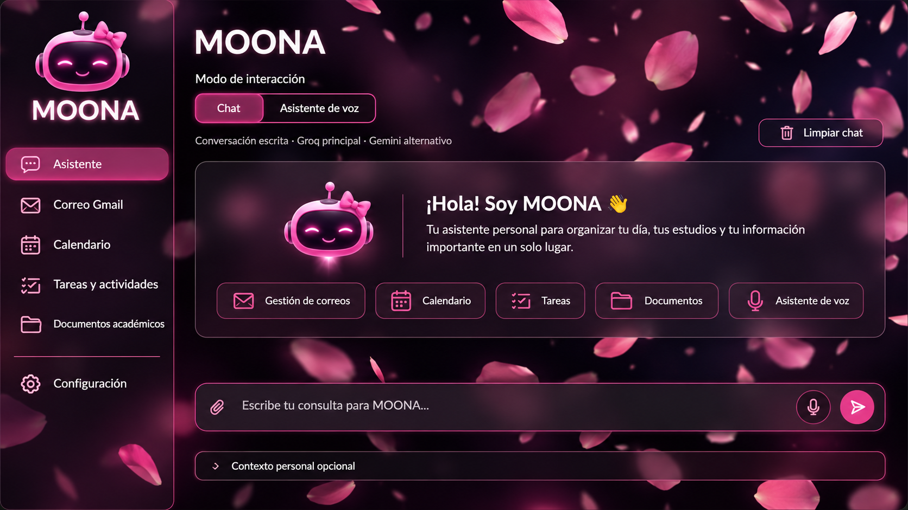
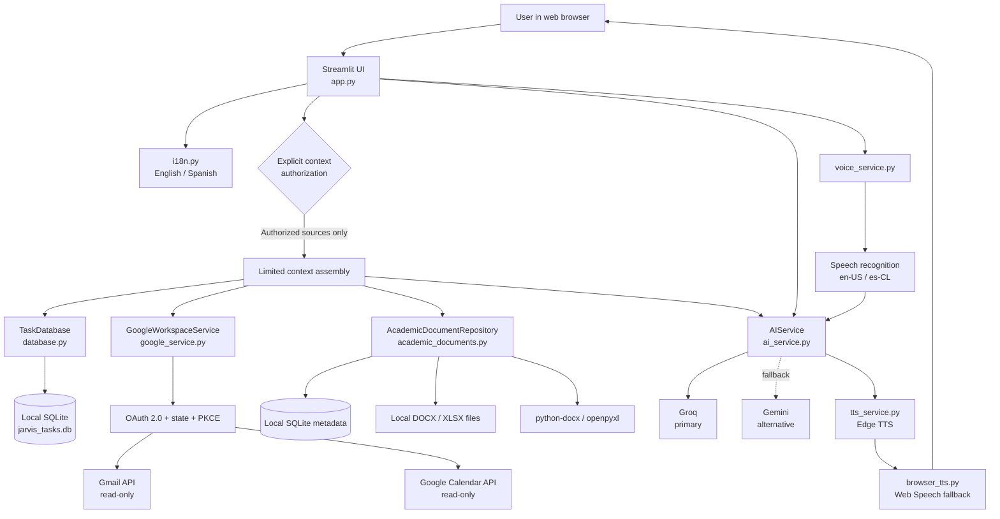

# MOONA — Intelligent Personal Assistant


MOONA is a bilingual personal AI assistant built with Python and Streamlit. It combines conversational AI, voice interaction, read-only Gmail and Google Calendar access, local task management, and academic document processing in a privacy-conscious desktop-oriented web application.

The project was originally developed as an academic project for **Universidad Central de Chile**, within the **Ingeniería en Informática y Sistemas Inteligentes** program, and has evolved into a software engineering portfolio project.

> MOONA runs locally. It is not published or hosted by this repository.

## Main Features

- **Bilingual interface:** English is the default language, with Spanish available from the sidebar. The preference is stored locally between sessions.
- **Conversational assistant:** Groq is the primary AI provider, with Gemini available as an automatic fallback.
- **Authorized personal context:** The user can explicitly authorize tasks, Gmail metadata, calendar events, and academic documents for an individual AI request or voice session.
- **Voice assistant:** Browser audio capture, speech recognition in `en-US` or `es-CL`, and automatically spoken responses.
- **Neural text-to-speech:** Edge TTS uses `en-US-AriaNeural` for English and `es-CL-CatalinaNeural` for Spanish, with the browser Web Speech API as a fallback.
- **Gmail integration:** Connect a Google account and search real messages using Gmail search syntax.
- **Google Calendar integration:** Read upcoming events from the connected calendar.
- **Task management:** Create, view, edit, complete, filter, and delete tasks stored in a local SQLite database.
- **Academic documents:** Upload, extract, inspect, download, and delete `.docx` and `.xlsx` files stored locally.
- **Local personalization:** The preferred user name and language are retained locally.
- **Responsive visual design:** Dark, futuristic Streamlit interface with a custom MOONA identity and responsive layout.

## Application Screenshots

### Interface design



### Visual identity

<p align="center">
  
</p>

The application uses the moon and cherry-blossom artwork in `assets/moona_background2.png` as its responsive background.

## Technology Stack

| Area | Technology |
| --- | --- |
| Application UI | Python, Streamlit, custom CSS |
| Primary AI provider | Groq official Python SDK |
| AI fallback | Google Gen AI SDK (`google-genai`) |
| Email and calendar | Gmail API, Google Calendar API |
| Authentication | Google OAuth 2.0 Authorization Code flow, `state`, and PKCE |
| Local persistence | SQLite via Python `sqlite3` |
| Speech recognition | `SpeechRecognition` with Google Speech Recognition |
| Neural speech synthesis | Edge TTS |
| Browser speech fallback | Web Speech API |
| Word processing | `python-docx` |
| Excel processing | `openpyxl` |
| Localization | Internal English/Spanish translation module |

## System Architecture



The Streamlit layer coordinates navigation and consent. Service modules remain separate from the interface, allowing AI, Google APIs, persistence, document extraction, and speech processing to evolve independently.

## Project Structure

```text
.
├── app.py                         # Streamlit interface and application orchestration
├── ai_service.py                  # Groq primary provider and Gemini fallback
├── google_service.py              # Google OAuth, Gmail, and Calendar access
├── database.py                    # SQLite task repository and CRUD operations
├── academic_documents.py          # DOCX/XLSX extraction and local persistence
├── voice_service.py               # In-memory speech recognition
├── tts_service.py                 # Edge TTS neural voice generation
├── browser_tts.py                 # Browser speech fallback and playback controls
├── i18n.py                        # English and Spanish UI translations
├── requirements.txt               # Python dependencies
├── .gitignore                     # Local data and credential exclusions
├── .streamlit/
│   ├── config.toml                # Streamlit theme configuration
│   └── secrets.toml.example       # Safe configuration template
└── assets/
    ├── moona_background2.png      # Active application background
    ├── moona_design.png           # Interface design preview
    └── moona_robot.png            # MOONA avatar and favicon source
```

Runtime-only files are created under `.data/` and `.streamlit/`. They are excluded from version control.

## Installation

### Prerequisites

- Python 3.10 or newer
- A modern browser with microphone support for voice mode
- A Groq API key for the primary AI provider
- An optional Gemini API key for automatic fallback
- A Google Cloud OAuth client for Gmail and Calendar features

### 1. Create a virtual environment

```powershell
python -m venv .venv
.\.venv\Scripts\Activate.ps1
```

On macOS or Linux:

```bash
python3 -m venv .venv
source .venv/bin/activate
```

### 2. Install dependencies

```bash
python -m pip install --upgrade pip
pip install -r requirements.txt
```

### 3. Create the local secrets file

Copy the provided template:

```powershell
Copy-Item .streamlit\secrets.toml.example .streamlit\secrets.toml
```

Then replace the placeholders in `.streamlit/secrets.toml`:

```toml
GEMINI_API_KEY = "YOUR_GEMINI_API_KEY"
GROQ_API_KEY = "YOUR_GROQ_API_KEY"

[google]
credentials_file = ".streamlit/credentials.json"
token_file = ".streamlit/token.json"
pending_file = ".streamlit/oauth_pending.json"
redirect_uri = "http://localhost:8501"
```

Never commit the completed secrets file.

### 4. Start MOONA

```bash
streamlit run app.py
```

Open `http://localhost:8501` if the browser does not open automatically.

## API and Google OAuth Configuration

### Groq

1. Create an API key in the Groq developer console.
2. Store it only as `GROQ_API_KEY` in `.streamlit/secrets.toml`.
3. MOONA uses Groq as its primary conversational provider.

### Gemini

1. Create an API key in Google AI Studio.
2. Store it only as `GEMINI_API_KEY` in `.streamlit/secrets.toml`.
3. MOONA uses Gemini only when the primary provider cannot complete the request.

### Google Cloud OAuth

1. Create or select a project in Google Cloud Console.
2. Enable the **Gmail API** and **Google Calendar API**.
3. Configure the OAuth consent screen.
4. If the application is in testing mode, add the Google account as a test user.
5. Create an OAuth client with application type **Web application**.
6. Add this authorized redirect URI:

   ```text
   http://localhost:8501
   ```

7. Download the OAuth client JSON and save it locally as:

   ```text
   .streamlit/credentials.json
   ```

8. Start MOONA and use the Google connection button. The resulting local token is stored in `.streamlit/token.json`.

MOONA requests only these delegated read-only scopes:

```text
https://www.googleapis.com/auth/gmail.readonly
https://www.googleapis.com/auth/calendar.readonly
```

The application does not request permission to send email, modify messages, or edit calendar events.

## Privacy and Security

- API keys are read from Streamlit secrets and are not embedded in source code.
- OAuth credentials, tokens, pending transactions, local preferences, databases, and uploaded documents are excluded through `.gitignore`.
- Google OAuth validates `state`, uses PKCE, and limits pending authorization transactions to ten minutes.
- Gmail and Calendar integrations use read-only scopes.
- Personal context is sent to the AI only after explicit user authorization.
- Context is intentionally limited: up to 10 tasks, 5 email metadata records, 5 events, and 5 documents with a maximum excerpt of 3,000 characters per document.
- Email bodies, calendar attendees, calendar links, credentials, and tokens are excluded from AI context.
- Voice recordings are processed in memory and are not permanently stored.
- Task database operations use parameterized SQL queries.
- Uploaded academic files are validated by extension and size, stored under non-predictable local names, and kept outside version control.

## English and Spanish Support

MOONA supports **English** and **Spanish** throughout the interface and assistant workflow:

- English is the default interface language.
- The selected language is retained locally between sessions.
- AI system instructions enforce the selected response language.
- Speech recognition uses `en-US` for English and `es-CL` for Spanish.
- English responses use the Aria neural voice.
- Spanish responses use the Catalina neural voice.
- Original Gmail messages, calendar events, task content, and document content are never automatically translated or modified.

## Future Improvements

- Mobile-oriented OAuth redirect and deployment configuration.
- Additional automated unit and integration test coverage.
- More granular controls for selecting individual context records.
- Optional encrypted local storage for application data.
- Additional document formats and improved long-document retrieval.
- Accessibility refinements and keyboard-first navigation.
- Configurable AI providers and models through a dedicated settings module.

## Author

**Daniela Durán**

Originally developed at **Universidad Central de Chile** as part of the **Ingeniería en Informática y Sistemas Inteligentes** program.

